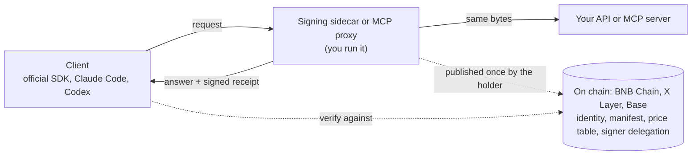

# TapeAPI

**A signed receipt for every AI call.** Put a sidecar in front of your OpenAI- or Anthropic-compatible API, and every
answer comes with a receipt anyone can check: who answered, to which request, with which bytes, and what usage and price
were claimed. Your users keep their official SDKs and change only the base URL.

TapeAPI is the signed API layer of [TapeOut](https://tapeout.net). The same on-chain identity and signatures also cover
MCP tools and end-to-end encrypted channels and groups, on BNB Chain, X Layer and Base.

[](https://github.com/BruceLanLan/tapeapi/actions/workflows/ci.yml)
[](LICENSE)
[](LICENSE-SPEC)
[](https://tapeapi.fun/docs/)
[](https://tapeapi.fun/playground/)
[](https://tapeapi.fun/status/)

[中文说明](README.zh-CN.md) · [Website](https://tapeapi.fun) · [Docs](https://tapeapi.fun/docs/) · [Guides](docs/guides/) · [Specifications](spec/) · [Examples](examples/) · [Changelog](CHANGELOG.md) · [Roadmap](docs/ROADMAP.md) · [Upgrading to 2.0](docs/guides/upgrade-2.0.md)

> **2.0: standards by default.** Pass no options and `createTapeAPI()` resolves a service the way TapeOut's official
> TAPs say: TAP-10 v1.1 §3 to §7 and TAP-11 §2, every read at one pinned block, strict agreement of the nodes on the
> chain and the owner, and a named status instead of a quiet success when a name was never opened (`not-opened`), is
> not activated or its payment has run out (`unpaid`), or TapeOut's site store or payment contract runs an
> implementation the SDK does not list (`store-changed`). TAP-11 and TAP-13 are drafts we wrote and submitted; the
> editors merged both into the official repository as **Drafts**, and a merge into Draft is not adoption. TAP-10 and
> TAP-11 are Drafts, so the default follows their text by one rule: a loosening or a new status name in a 2.x minor
> release, a tightening first as an optional profile and the default in 3.0. The 1.x behaviour is one option away,
> `conform: false` (deprecated, kept in all of 2.x). One known exception: without `allChains`, a processor
> contract#ID is refused; see [Upgrading to 2.0](docs/guides/upgrade-2.0.md). Also in 2.0: private channels and groups
> use the `tape-channel/` and `tape-group/` labels the TAPs editors asked for.
> [New in 2.0](#new-in-20) · [Upgrading to 2.0](docs/guides/upgrade-2.0.md)

> **Experimental, first public in 2.0: bounded agents.** An AI agent may spend for a container, and the most it can lose
> is fixed by an escrow contract and checkable on chain by anyone: one escrow channel per service, a one-off session key
> for the agent, a limiter that never signs past the cap, and orders that resume after a restart with the keys and order
> records kept encrypted. **The limits, plainly:** the escrow contract is **not audited and not deployed**, so none of
> this works on mainnet today; it is checked on local chains and in tests only, and `@tapeapi/sdk/agent` is outside the
> 2.x compatibility promise. [Bounded agents](#bounded-agents-experimental-not-usable-on-mainnet)

> **Status: released, 2.1.0.** Everything live today is free. TapeAPI follows semantic versioning: code written to the
> 2.0 docs keeps working in every 2.x release, and 1.x receives security fixes for 6 months after 2.0.0. Paid calls
> (TAPI-22) are experimental and not deployed. Nothing here has had a third-party audit. **Security note:** on 1.0.0 to
> 1.4.0, streamed AI receipt verification could, under particular chunking, report a truncated or content-injected
> stream as verified; it was fixed in 1.5.0
> ([release notes](https://github.com/BruceLanLan/tapeapi/releases/tag/v1.5.0)).

## What it does

- **Signed answers and receipts** (Stable since 1.0). Every answer is signed by a key the circuit's holder delegated on
  chain and bound to its request; an AI call also gets a usage receipt, priced from the table on chain.
  [Call a service](docs/guides/consume.md) · [For AI providers](docs/guides/ai-providers.md)
- **Resolution as TapeOut's official TAPs say** (the default since 2.0). A name is resolved as TAP-10 v1.1 and
  TAP-11 §2 (a Draft) say, at one pinned block, with a status from the TAPs (`e.data.status`) on every failure. Introduced in 1.4
  as the opt-in `conform: 'tap10'`; `conform: false` keeps the 1.x resolution through 2.x. Its status names only grow,
  and they are experimental in 2.0.
  [Upgrading to 2.0](docs/guides/upgrade-2.0.md#conformance-becomes-the-default)
- **MCP tools** (Stable since 1.0). Signed results with a receipt, and tool definitions pinned on chain by their hash:
  a public endpoint, a signing proxy for your own server, and `tapeapi-mcp` to check every answer locally.
  [MCP](docs/guides/mcp.md)
- **Private channels and groups** (Stable since 1.0; version 2 of their specs, with `tape-channel/` and `tape-group/`
  labels, is the default since 2.0). End-to-end encrypted, between containers, over a relay or ChannelBus.
  [Channels](docs/guides/channels.md) · [Groups](docs/guides/groups.md)
- **Streamed AI receipts, with usage you can check** (1.5 to 1.6). A streamed receipt fails when the stream was cut
  short or had content added; the opt-in `requestUsage` puts the usage of a streamed OpenAI Chat answer inside the
  signed stream so it is checked like a whole answer's (it does not prove the upstream's own count).
  [Streamed usage: three ways](docs/guides/ai-providers.md#the-usage-of-a-streamed-chat-answer-three-ways)
- **Container agents** (experimental). Phase 0 (1.7): a holder-signed mandate, a task thread from offer to acceptance,
  and a read-only payment check, with no new contract and no enforcement. Bounded agents (2.0): a mandate that names
  funds, enforced by escrow channels, on local chains and in tests only.
  [Container agents](docs/guides/container-agents.md) · [Bounded agents](#bounded-agents-experimental-not-usable-on-mainnet)
- **Prices in US dollars, paid in BEM, and reviews between containers** (2.0, experimental). The reference
  implementations of two TAP drafts we submitted as pull requests (#52 and #54), not merged. No escrow is deployed, so no call is charged.
  [Below](#also-experimental-in-20)

## New in 2.0

2.0 has one theme: what we submitted to TapeOut's official TAP process, and what TapeOut itself specifies, is what the
SDK does when you pass nothing, with one known exception (below). Every breaking change, with what to write instead, is in
[Upgrading from 1.x to 2.0](docs/guides/upgrade-2.0.md); the wire formats and frozen constants of TAPI-20 to TAPI-27 do
not change, so a 2.0 client verifies every 1.x manifest, delegation, signed response and receipt.

### Standards by default

```js
import { createTapeAPI, rpcUrlsFor } from '@tapeapi/sdk'

// 2.0: TAP-10 / TAP-11 §2 resolution, exactly what conform: 'tap10' did in 1.x
const api = createTapeAPI({ rpcUrls: rpcUrlsFor(56) })
// 2.0: the 1.x resolution, request for request (deprecated; kept in all of 2.x; one onWarning when the client is made)
const legacy = createTapeAPI({ rpcUrls: rpcUrlsFor(56), conform: false })
```

| | 1.x default | 2.0 default |
|---|---|---|
| Which resolution | TapeAPI's own (TAPI-20) | TAP-10 v1.1 §3 to §7 and TAP-11 §2 |
| Block the reads use | Latest, unpinned | One TAP-10 pinned block, confirmed by number and hash |
| Agreement of the nodes | The majority of the operators | All operators must answer and agree on `eth_chainId`, `ownerOf` and a contract holder's EIP-1271 calls; the majority on the rest |
| A name that was never opened | Resolves if the manifest is valid | `SITE_STATUS`, `data.status: 'not-opened'` |
| A name not activated, or whose payment has run out | Resolves | `SITE_STATUS`, `data.status: 'unpaid'` |
| TapeOut upgrades the site store or the payment contract | Resolves with a warning | `CONTRACT_UNKNOWN`, `data.status: 'store-changed'` (fails closed until a patch release lists the new implementation) |
| Your own addresses, a local chain or fork, an explicit `pin` | Allowed | `INVALID_ARGUMENT` when the client is made, naming `conform: false` |
| A processor contract#ID string | Resolved on this client's chain | `INVALID_ARGUMENT`, `data.status: 'unsupported'`, unless `allChains: true` (a known exception to TAP-11 §2.1) |
| How long a manifest is kept | 3,600 seconds | 60 seconds |

TAP-10 and TAP-11 were merged as Drafts (a merge is not an adoption), so their text can still change. When it does, a
loosening or a new status name becomes the default in a 2.x minor release; a tightening is offered first as an optional
new profile and becomes the default in 3.0. Status names only grow. `conform: false` does not follow the TAPs at all.
[How the default follows changes](docs/guides/upgrade-2.0.md#how-the-default-follows-changes-in-the-official-taps)

- **Branch on `e.data.status`**, not on messages: the status names are the lowercase names the TAPs use (`unsupported`,
  `hub-changed` and `container-mismatch` are TapeAPI's own). Names only grow, and `data.status` is experimental in 2.0
  (it follows a Draft); it is considered for Stable after TAP-11's review period ends with no unresolved objection.
  `not-opened` and `unpaid` are for the provider to fix (do not retry), `store-changed` means update the SDK
  (`conform: false` is the stop-gap), `unavailable` is a node problem (retry, or add an operator of your own).
- **The command lines follow.** `tapeapi-verify`, `tapeapi-mcp` and `tapeapi-doctor` use the new default, say which
  resolution they used, and take `--no-conform` for the 1.x one. In the default, `tapeapi-doctor` now **fails** a name
  that is not activated (a default client cannot resolve it); with `--no-conform` it is still a warning.
- **The agent toolkit too.** `createAgentKit` (`@tapeapi/sdk/agent`, experimental) resolves the agent and the providers
  as TAP-11 §2 says when you give it no `resolve`.
- **`dev: true` means `conform: false`**, without a warning: development mode never checks the chain identity.
- **What it costs.** Measured on BNB Smart Chain with the default nodes, a cold resolution of one service sends about 45
  JSON-RPC calls instead of about 24 (about 2 times); a repeated one on the same client about 36 instead of about 9
  (about 4 times). If a public node rate-limits you, add an operator of your own to `rpcUrls`.
- **How we checked.** A differential run over 637 cases: `conform: false` made the same requests in the same order with
  the same results as 1.8.1's default in all 637 (the only differences allowed: the deprecation warning, and the
  version-2 inbox room that `chain.channelKeys` reports). Our own services `11.1013.tape` and `12.1013.tape` resolve on
  mainnet with the TAP-10 resolution; both are activated, paid until 2036-08-09.
- **If you provide a service:** run `tapeapi-doctor <your name>` from a 2.0 install. If its first seven checks pass
  (name to delegation), a 2.0 client resolves you; the checks after them are for AI services, so a service that is not
  one fails at `ai-field`, as in 1.x. If the name's payment runs out, 2.0 clients see `unpaid`, and the receipt checker can no longer check
  receipts your service signed while it was paid.

### Other breaking changes

- **Private channels and groups use TAPI-26 v2 and TAPI-27 v2 by default:** labels that begin with `tape-channel/` and
  `tape-group/` instead of `TAP-26/` and `TAP-27/`, as the TAPs editors asked before merging the drafts #12 and #20.
  `labels: 'v1'` selects version 1 (deprecated in 2.x, not removed in 2.x). The two versions do not interoperate, and
  nothing fails open: a mismatched pair times out or gets a named mismatch (`data.labels`, `data.peerLabels`). A group
  keeps its version for life, so a 1.x group resumes as a version-1 group. Channel records, relays and ChannelBus are
  unchanged; holders sign nothing again.
- **`TapeAPIError` loses the deprecated top-level aliases** of the fields in `e.data`: read `e.data.*`, where every
  detail has been since 1.0 (the list is in the upgrade guide).
- **The channel module reports a mistake in your own options or arguments as `INVALID_ARGUMENT`**, like every other
  module; TAPI-26 data that fails stays `CHANNEL_INVALID`.

### Bounded agents (experimental, not usable on mainnet)

Phase 0 (1.7) records who may act for a container and on which task, and enforces nothing. Bounded agents are phase 1:
an agent may spend for a container, and the most the container can lose is fixed by an escrow contract and checkable on
chain. The circuit's holder funds one escrow channel per service the agent may pay, and authorises a key made for that
one mandate as a session key on those channels until the mandate expires. A leaked or misbehaving agent key can cost at
most what was put in those channels, and only toward the services the mandate names.

- **The check.** `verifyMandate` and `verifyTaskThread` with `{ enforcement: 'escrow-channel' }` read every capped
  channel at one pinned block and report the mandate as enforced only when every reading passes; what the chain bounds
  is always the channel's balance (`bound: 'channel'`).
- **The holder's plan.** `holderPlan` reads its facts from the chain and returns the unsigned `approve`, `fund` and
  `authorizeSession` transactions, from the holder's wallet or through the container; `afterPlan` reads them back and
  `closeOut` withdraws what is left. A session history keeps a plan run twice from funding the same key twice.
- **The agent's own limit.** `createSpendLimiter` never signs a voucher past the channel's `claimedOf` at the start plus
  the cap, and by default refuses a single call above 10% of the cap.
- **Restarts.** With a key vault (`passphraseKeyVault`: scrypt and XChaCha20-Poly1305), the agent's session keys and,
  in `examples/agent-service`, its order records are kept sealed; `resume` continues an order after a restart and
  never one that was stopped, revoked or expired.
- **What a delivery says about money.** A delivery may carry the agent's signed spend statement, reconciled against the
  chain and the receipts.

**The limits.** The escrow contract this relies on (TAPI-22, `contracts/src/TapeAPIEscrow.sol`) is **not audited and not
deployed** on any chain, and the SDK's list of audited escrows is empty, so none of this works on mainnet. It is checked
on the SDK's fake chain (`node --test examples/agent-service/agent-service-spend.test.mjs`) and, for the transactions and
vouchers, against a local copy of the escrow (`cd contracts && forge test --match-path 'test/Phase1*'`). It is
experimental and outside the 2.x compatibility promise. The phase-1 TAP draft is submitted as
[TapeOutProtocol/TAPs#60](https://github.com/TapeOutProtocol/TAPs/pull/60) (open as a draft PR for now), and the escrow interface it relies on as [#59](https://github.com/TapeOutProtocol/TAPs/pull/59) (open as a draft PR for now).

### Also experimental in 2.0

- **Prices in US dollars, paid in BEM** ([TAPI-22](spec/TAPI-22.md) §3.6; the TAP draft
  [#52](https://github.com/TapeOutProtocol/TAPs/pull/52), an open pull request). A manifest may price methods in US dollars; a
  provider states a BEM rate in a signed quote, the client checks it against on-chain reference pools before it signs a
  voucher, and every priced answer carries a signed charge record. A method's `priceBEM` stays the most one call can
  cost. A manifest without `usdPricing` answers and pays byte for byte as before. No escrow is deployed, so nothing is
  charged.
- **Reviews between containers** (`@tapeapi/sdk/review`; the TAP draft
  [#54](https://github.com/TapeOutProtocol/TAPs/pull/54), an open pull request). A review is signed by the reviewer's holder or
  delegate and counts only with evidence: a signed answer the reviewer received, or a task thread between the two
  containers. Summaries count distinct reviewers and holders, never amounts. `tapeapi-verify review <name>` prints them.

## Start here

| You are | Your first five minutes | Guide |
|---|---|---|
| **An AI provider or relay** (new-api, a gateway, your own models) | `docker compose up` in [`examples/new-api-sidecar`](examples/new-api-sidecar/), publish your price table in the [holder console](https://tapeapi.fun/console/), point your users' base URL at the sidecar, then run `tapeapi-doctor <your name>` | [For AI providers](docs/guides/ai-providers.md) |
| **An MCP server author** | Run the [signing proxy](examples/mcp-proxy/) in front of your server, then publish the manifest with the console | [Tape out your MCP server](docs/guides/mcp.md#tape-out-your-own-mcp-server) |
| **An app developer** | Run the examples below; check AI receipts with `createVerifyingFetch`; start channels and groups from [`examples/group-chat`](examples/group-chat/) | [Call a service](docs/guides/consume.md) · [Channels](docs/guides/channels.md) · [Groups](docs/guides/groups.md) |
| **Upgrading from 1.x** | Search your code for `conform`, `labels`, the top-level `TapeAPIError` aliases and `CHANNEL_INVALID`; add `conform: false` where you use your own addresses or a local chain | [Upgrading to 2.0](docs/guides/upgrade-2.0.md) |
| **A TapeOut circuit holder** | Open your circuit's container and activate its name, then generate a service key, sign the delegation and publish the manifest in the console | [Run a service](docs/guides/provide.md) |
| **A Claude, Cursor or other MCP user** | Add `https://api.tapeapi.fun/mcp` as a connector | [MCP](docs/guides/mcp.md) |
| **Hiring an agent for a container, or building one** (experimental) | Run `node examples/agent-service/hire.mjs` from a checkout and read what each step asks a wallet to sign | [Container agents](docs/guides/container-agents.md) |

## Try it

**A signed answer.** The public service `11.1013.tape` answers eight free, block-pinned reads of BNB Chain:

```bash
curl -s https://api.tapeapi.fun/tapeapi/v1/bnbUsd -H 'content-type: application/json' -d '{"id":"1","params":{}}'
```

curl shows the signed envelope but checks nothing. The SDK checks it. It is not on npm yet; install it from the GitHub
release (Node.js 20 or later):

```bash
npm install https://github.com/BruceLanLan/tapeapi/releases/download/v2.1.0/tapeapi-sdk-2.1.0.tgz
```

The server package (`@tapeapi/server`: providers, the AI sidecar, the MCP proxy) depends on this SDK, which is not on
npm either, so installed alone it fails with a 404: install both in one command,
`npm install https://github.com/BruceLanLan/tapeapi/releases/download/v2.1.0/tapeapi-sdk-2.1.0.tgz https://github.com/BruceLanLan/tapeapi/releases/download/v2.1.0/tapeapi-server-2.1.0.tgz`.

```js
// try.mjs: node try.mjs
import { createTapeAPI, rpcUrlsFor } from '@tapeapi/sdk'

const api = createTapeAPI({ rpcUrls: rpcUrlsFor(56) })   // nodes of 3 distinct operators; most reads need 2 to agree,
                                                          // ownerOf and eth_chainId need all 3 (strict)
const service = await api.resolve('11.1013.tape')         // TAP-10 / TAP-11 §2: one pinned block, opened, activated
const { result, verified } = await api.call(service, 'bnbUsd', {})
console.log(result.bnbUsd, verified)                      // true only after the signature checked out
```

When a resolution fails, `e.data.status` says why, in the TAPs' own words:

```js
try {
  await api.resolve('11.1013.tape')
} catch (e) {
  if (e.data?.status === 'not-opened' || e.data?.status === 'unpaid') { /* the provider's to fix: do not retry */ }
  else if (e.data?.status === 'unavailable') { /* a node did not answer or disagreed: retry */ }
  else throw e
}
```

**A local service, a local chain or your own deployment.** Development mode needs no option beyond `dev`; a chain that
is not a TapeOut chain TAP-10 lists needs `conform: false`, or `createTapeAPI()` stops with `INVALID_ARGUMENT`:

```js
const dev = createTapeAPI({ dev: true })                 // a local http:// service without an on-chain manifest
const local = createTapeAPI({                            // an anvil chain with your own TapeOut contracts
  rpcUrls: ['http://127.0.0.1:8545'], allowSingleNode: true, allowHttp: true,
  chainId: 31337, hub: HUB, factory: FACTORY, siteRegistry: SITE_REGISTRY,
  conform: false,                                        // the 1.x resolution; deprecated, kept in 2.x
})
```

**AI receipts.** Plug `createVerifyingFetch` into the official OpenAI SDK (`npm install openai`; the Anthropic SDK
takes a `fetch` too). Replace `42.1013.tape` with the provider's TapeOut name:

```js
import OpenAI from 'openai'
import { createTapeAPI, rpcUrlsFor, ai } from '@tapeapi/sdk'

const api = createTapeAPI({ rpcUrls: rpcUrlsFor(56) })
const service = await api.resolve('42.1013.tape')        // the AI provider's name (an example)
const { baseUrl } = service.manifest.ai.endpoints.find((e) => e.format === 'openai-chat')
const client = new OpenAI({
  baseURL: baseUrl,                                      // the address the provider published on chain
  apiKey: process.env.API_KEY,                           // your key with that provider, as before
  fetch: ai.createVerifyingFetch({ api, service }),      // checks every receipt; a bad one throws
})
const r = await client.chat.completions.create({ model: 'gpt-4o-mini', messages: [{ role: 'user', content: 'Hello' }] })
console.log(r.choices[0].message.content)
```

No outside provider has published a price table on chain yet, so this was run against the reference sidecar in
[`examples/ai-proxy`](examples/ai-proxy/) (local dev mode); with a real provider only the name changes.

**Claude Code and Codex** cannot read receipts themselves. Run the local verifying proxy and point them at it:

```bash
# Terminal 1 (it keeps running). 42.1013.tape is an example name: put your AI provider's TapeOut name here
npx -y --package=https://github.com/BruceLanLan/tapeapi/releases/download/v2.1.0/tapeapi-sdk-2.1.0.tgz tapeapi-verify 42.1013.tape
```

```bash
# Terminal 2, macOS or Linux
ANTHROPIC_BASE_URL=http://127.0.0.1:8790 claude
OPENAI_BASE_URL=http://127.0.0.1:8790/v1 codex             # Codex (or base_url in config.toml)
```

```powershell
# Terminal 2, Windows PowerShell
$env:ANTHROPIC_BASE_URL="http://127.0.0.1:8790"; claude
$env:OPENAI_BASE_URL="http://127.0.0.1:8790/v1"; codex
```

`tapeapi-verify` prints a `resolution:` line saying which resolution it used; `--no-conform` gives the 1.x one. Run as
written, `tapeapi-verify 42.1013.tape` stops: the name is an example and no service is published under it. To watch a
receipt verify end to end without any provider, run the local trial (no key, no circuit, no cost) from a checkout of
this repository, after installing its dependencies once at its root:

```bash
git clone https://github.com/BruceLanLan/tapeapi.git && cd tapeapi
npm ci --no-audit --no-fund
node examples/relay-trial/trial.mjs
```

Running an AI service yourself? Start at [From zero to live](docs/guides/ai-providers.md#from-zero-to-live); the
provider's check, `tapeapi-doctor` (experimental), ships in the same release package.

**MCP.** The same eight reads are tools at `https://api.tapeapi.fun/mcp`, with a signed receipt on every result:

```bash
claude mcp add --transport http tapeapi https://api.tapeapi.fun/mcp
```

No install at all: the [playground](https://tapeapi.fun/playground/) runs the SDK in your browser.

## How it fits together



| Layer | What it is | Spec |
|---|---|---|
| **Identity** | A TapeOut circuit's ERC-6551 container. Whoever holds the circuit owns the service; transfer the circuit and the service moves with it. Resolved as TAP-10 and TAP-11 §2 say. | [TAPI-20](spec/TAPI-20.md), [TAP-11](https://github.com/TapeOutProtocol/TAPs/blob/main/TAPs/TAP-11.md) (Draft) |
| **Manifest** | `.well-known/tapeapi.json` in the container's on-chain site: endpoints, methods, the AI price table, the hash of MCP tool definitions, the signing key and the holder's delegation of it. | [TAPI-20](spec/TAPI-20.md) |
| **Signed answers and receipts** | Every answer is signed and bound to its request; AI calls get a usage receipt. | [TAPI-21](spec/TAPI-21.md), [TAP-13](https://github.com/TapeOutProtocol/TAPs/blob/main/TAPs/TAP-13.md) (Draft) |
| **Channels and groups** | End-to-end encrypted, over a relay or ChannelBus; the carrier sees ciphertext only. | [TAPI-26 v2](spec/TAPI-26-v2.md), [TAPI-27 v2](spec/TAPI-27-v2.md) |

## What a receipt proves, and what it does not

A receipt proves **who answered** (a key the circuit's holder delegated on chain), **to exactly which request bytes**,
**with exactly which response bytes**, and **what usage and price were claimed**, priced from the table on chain.

It does **not prove which model actually ran**: a provider could label a cheaper model's answer as a dearer one. What
the signature adds is accountability. A receipt cannot be disowned, so anyone running the
[spot-check probe](examples/spot-check/) and publishing the results leaves evidence.

## Status and commitments

- **Live, free, no sign-up:** the public service `api.tapeapi.fun` (8 methods), its MCP endpoint, the public relay
  `relay.tapeapi.fun` (`relaySend`, `relayHandshake`, `relayRecv`),
  [ChannelBus](https://bscscan.com/address/0x486110c35d9b90a9d6D85c8063A065f9e7b6b707), and the website's
  [console](https://tapeapi.fun/console/), [receipt checker](https://tapeapi.fun/verify/),
  [playground](https://tapeapi.fun/playground/) and [status page](https://tapeapi.fun/status/).
- **Available, you run it:** the AI signing sidecar and the new-api package, the MCP signing proxy, `tapeapi-verify`,
  `tapeapi-mcp`, the spot-check probe, and one-call group delivery (`deliverGroupUpdate`) in the SDK.
- **Experimental, not deployed:** paid calls and the escrow ([TAPI-22](spec/TAPI-22.md), with prices in US dollars paid
  in BEM in §3.6), the service directory, and circuit-verified methods ([TAPI-25](spec/TAPI-25.md)).
- **Experimental, in the SDK:** container agents (`@tapeapi/sdk/agent`: phase 0 since 1.7, bounded agents since 2.0,
  local chains only) and reviews (`@tapeapi/sdk/review`, since 2.0), outside the 2.x compatibility promise.
- **What 2.0 promises:** code written against the 2.0 docs keeps working in every 2.x release; everything is Stable
  except what is marked `@experimental` or `@internal`. That includes `data.status`, `SiteStatus` and `svc.conform`,
  which follow Drafts: TAP-10 and TAP-11 are Drafts, so the default follows their text by one rule, a loosening or a new
  status name in a 2.x minor release, a tightening first as an optional profile and the default in 3.0.
  `conform: false` and `labels: 'v1'` are deprecated and kept in all of 2.x. 1.x receives security fixes for 6 months after 2.0.0. Coming from 1.x:
  [Upgrading to 2.0](docs/guides/upgrade-2.0.md).
- **What we do not do:** host the sidecar for anyone (it sees your users' API keys, so you run it); issue a token;
  help anyone get around an upstream provider's bans or regional limits (TapeAPI is for providers working within their
  upstream's terms).
- **Chains:** BNB Chain (chainId 56) for everything, and the only chain where payments will run. X Layer (196) and Base
  (8453) are read-only: identity, resolution, receipts and MCP checks. X Layer has only two independent RPC operators,
  and under the 2.0 default both must answer every strict read.
- **No third-party audit.** Tests: the JavaScript suite (`npm test`), the contract tests (`forge test`) and an
  independent Python implementation of every signature, hash and encoding (`python3 spec/vectors/verify.py`), all
  three run by CI on every push. On the 2.1.0 release commit, `npm test` in this repository runs
  2,121 JavaScript tests: 2,118 pass, 3 are skipped, none fail.

## Privacy, plainly

- **Protected:** channel and group content (end-to-end encrypted); AI receipts carry hashes only, and requests sent
  through the SDK or `tapeapi-verify` get 128 random bits of whitespace, so a short prompt cannot be confirmed from its
  hash; MCP verification links carry hashes only by default; the SDK's `busPrivacyReader` (experimental) reads all of ChannelBus and
  filters locally, so nodes cannot see your rooms.
- **Not hidden:** a service sees what it processes (your request, your IP, your API key); public RPC nodes see your IP
  and which service you check; relays and the chain see channel rooms, timing and sizes; everything on chain is public,
  including future payments. `allChains` stays off by default in 2.0, because turning it on sends your queries to the
  public nodes of the other chains. This is why a processor contract#ID string is refused by default (a known exception
  to TAP-11 §2.1; see [Upgrading to 2.0](docs/guides/upgrade-2.0.md)).

## Fees

No mandatory protocol fee; a default 1% maintenance contribution that any provider can turn off; the operator has no fee
switch. The contribution applies only when a paid channel settles, out of the provider's share, and the user's price does
not change. A provider can also set more, up to the contract's cap of 20%. The paid-call escrow is not deployed, so
**no call is charged today**. AI providers bill their users off chain as they do now; the prices in their manifest are
published, not settled. The escrow that goes to audit is planned to hold BEM first, with the USDT peg and WBNB on
demand ([TAPI-22](spec/TAPI-22.md) §3.5). See [docs/FEES.md](docs/FEES.md).

## Specifications

These are TapeAPI's own specifications, not TAPs. TapeOut publishes its standards as TAPs, numbered by its editors in
[TapeOutProtocol/TAPs](https://github.com/TapeOutProtocol/TAPs) under TAP-01. We submitted fourteen TAP drafts for parts of
them: eight on 2026-09-30 and 2026-10-01, two on the container-agent formats on 2026-10-04 and 2026-10-05, two on
2026-10-08 (payment vouchers, reviews), and two on 2026-10-13 (escrow channels, bounded agents). Two are merged as Drafts
(TAP-11, TAP-13) and twelve are open pull requests; three of them (#54, #59, #60) are draft PRs for now, so they don't take the editors' queue. One more draft, an Information draft, #61 (a privacy map), is submitted and open as a draft PR for now. Editors
review the format, not the merits (TAP-01 §4), so a merge into Draft is not adoption. TAPI-20 to TAPI-27 (with the
version 2 of TAPI-26 and TAPI-27) remain the basis of the 2.x compatibility promise.

| Our spec | Draft (pull request) | Status, as of 2026-10-17 |
|---|---|---|
| TAPI-20 (core: §3.1 to §3.4, §3.6, §3.10) | Service identity and manifest, [#8](https://github.com/TapeOutProtocol/TAPs/pull/8) | Merged on 2026-10-01 as [TAP-11](https://github.com/TapeOutProtocol/TAPs/blob/main/TAPs/TAP-11.md), Draft. The 2.0 default resolves as its §2 says |
| TAPI-21 | Signed responses, [#10](https://github.com/TapeOutProtocol/TAPs/pull/10) | Merged on 2026-10-04 as [TAP-13](https://github.com/TapeOutProtocol/TAPs/blob/main/TAPs/TAP-13.md), Draft |
| TAPI-26 (v2) | Private channels, [#12](https://github.com/TapeOutProtocol/TAPs/pull/12) | Open; uses the `tape-channel/` labels the editors asked for, the 2.0 default |
| TAPI-20 §3.8, TAPI-21 | MCP tool binding, [#16](https://github.com/TapeOutProtocol/TAPs/pull/16) | Open; the drafts it requires (TAP-11, TAP-13) are merged as Drafts |
| TAPI-23 | Attested reads from independent services, [#18](https://github.com/TapeOutProtocol/TAPs/pull/18) | Open; the drafts it requires (TAP-11, TAP-13) are merged as Drafts |
| TAPI-27 (v2, format 1 only) | Private groups, [#20](https://github.com/TapeOutProtocol/TAPs/pull/20) | Open; uses the `tape-group/` labels the editors asked for, the 2.0 default |
| TAPI-20 §3.9, TAPI-21 §3.5 | AI usage receipts, [#26](https://github.com/TapeOutProtocol/TAPs/pull/26) | Open; revised after the editors' answers in #25 |
| TAPI-20 §3.2 (proof mode, informative) | Proof-verified reads, [#28](https://github.com/TapeOutProtocol/TAPs/pull/28) | Open |
| Container agent mandates and task messages, phase 0 (no TAPI spec) | [#47](https://github.com/TapeOutProtocol/TAPs/pull/47) | Open |
| The agent member of the service manifest (the listing part of #41) | [#49](https://github.com/TapeOutProtocol/TAPs/pull/49) | Open |
| TAPI-22 §3.1, §3.2, §3.6 | Payment vouchers: prices in US dollars, settled in BEM, [#52](https://github.com/TapeOutProtocol/TAPs/pull/52) | Open |
| No TAPI spec (`@tapeapi/sdk/review`) | Evidence-backed reviews between containers, [#54](https://github.com/TapeOutProtocol/TAPs/pull/54) | Open (draft PR) |
| TAPI-22 §3.3 to §3.5 (the escrow interface) | Escrow channels for paying container services (Standards), [#59](https://github.com/TapeOutProtocol/TAPs/pull/59) | Open (draft PR) |
| Container agents, phase 1: bounded agents (no TAPI spec) | Container agent mandates enforced by escrow channels, phase 1, [#60](https://github.com/TapeOutProtocol/TAPs/pull/60) | Open (draft PR) |
| No TAPI spec (an Information draft) | Privacy map for container sites, messages and services (Information), [#61](https://github.com/TapeOutProtocol/TAPs/pull/61) | Open (draft PR) |
| Edits to TAP-11 | Security note on `verifyingContract` [#35](https://github.com/TapeOutProtocol/TAPs/pull/35) and Chinese translation [#36](https://github.com/TapeOutProtocol/TAPs/pull/36); dropping the `TAP-26/` label mention [#51](https://github.com/TapeOutProtocol/TAPs/pull/51); two sentences on `priceBEM` as a per-call upper bound and the escrow's chain [#53](https://github.com/TapeOutProtocol/TAPs/pull/53); the reference implementation brought up to date, with a mainnet vector that ends in `resolved` [#55](https://github.com/TapeOutProtocol/TAPs/pull/55) | #35 and #36 merged on 2026-10-04; #51, #53 and #55 waiting for the editors |
| Edits to TAP-13 | Wording on reserved names, [#46](https://github.com/TapeOutProtocol/TAPs/pull/46); an outdated sentence in the reference implementation section [#56](https://github.com/TapeOutProtocol/TAPs/pull/56) | #46 merged on 2026-10-05; #56 waiting for the editors |

TAPI-22 (other than §3.1 to §3.6), TAPI-24 and TAPI-25 have not been submitted. When the editors assign numbers to the
other drafts, we rename our references to them.

| Spec | Title | Status |
|---|---|---|
| [TAPI-1](spec/TAPI-1.md) | TapeAPI's document process and statuses, with Stable (vN) | Draft |
| [TAPI-20](spec/TAPI-20.md) | Service identity and manifest, with the AI price table and multi-chain names | Stable (v1); §3.5 Experimental |
| [TAPI-21](spec/TAPI-21.md) | Signed response envelope, with AI usage receipts | Stable (v1) |
| [TAPI-22](spec/TAPI-22.md) | Metered payment: vouchers and escrow; custody assets (§3.5, BEM first) and prices in US dollars paid in BEM (§3.6) | Experimental |
| [TAPI-23](spec/TAPI-23.md) | Attested read, cross-checked by independent providers | Stable (v1) |
| [TAPI-24](spec/TAPI-24.md) | Intent RFQ | Withdrawn |
| [TAPI-25](spec/TAPI-25.md) | Circuit-verified methods | Experimental |
| [TAPI-26 v2](spec/TAPI-26-v2.md) | Private channels between containers, `tape-channel/` labels | Stable (v2), the SDK's default since 2.0 |
| [TAPI-27 v2](spec/TAPI-27-v2.md) | Private groups of up to 32 containers (up to 128 in the experimental format 2), `tape-group/` labels | Stable (v2), the SDK's default since 2.0 |
| [TAPI-26](spec/TAPI-26.md), [TAPI-27](spec/TAPI-27.md) | Version 1 of the two: the same, with the frozen `TAP-26/…` and `TAP-27/…` labels | Stable (v1); `labels: 'v1'` in 2.x (deprecated) |

The specs are bilingual; English is authoritative. **TAPI-1 and TAPI-20 to TAPI-27 are TapeAPI's own document names,
not TAP numbers.** Frozen constants that contain an old name, such as the `TAP-26/…` and `TAP-27/…` labels of version 1,
never change; version 1 stays Stable (v1) and is not withdrawn earlier than 12 months after version 2 became Stable
(TAPI-1 §4.1).

## Repository

[`sdk/`](sdk/) `@tapeapi/sdk` (resolve, call, verify, AI receipts, channels, groups, MCP, container agents, reviews) ·
[`server/`](server/) `@tapeapi/server` (providers, the AI sidecar, the MCP proxy) ·
[`contracts/`](contracts/) (ChannelBus, and the experimental escrow and directory) ·
[`spec/`](spec/) (the specs, test vectors, the Python verifier) · [`examples/`](examples/) ·
[`conformance/`](conformance/) · [`site/`](site/) (the website) · [`docs/`](docs/README.md).
Contract addresses are in the [introduction](docs/guides/introduction.md#on-chain-addresses).

Report security issues privately as described in [SECURITY.md](SECURITY.md). Issues and pull requests are welcome; see
[CONTRIBUTING.md](CONTRIBUTING.md) and the [Code of Conduct](CODE_OF_CONDUCT.md).

## License

Code is MIT ([LICENSE](LICENSE)): `contracts/`, `sdk/`, `server/`, `examples/`, `conformance/`, `scripts/`, `site/`.
The specifications in `spec/` are CC0-1.0 ([LICENSE-SPEC](LICENSE-SPEC)).

## Credits

The idea of a service layer for TapeOut, "DeWEB is websites, TapeSend is messaging, TapeAPI is services", came from
**[@Theairresearch](https://x.com/Theairresearch/status/2101640697426448632)**. From 2026-10-05, 10% of TapeAPI's revenue each quarter,
after the direct cash costs paid to third parties, goes to them permanently (definition in BUSINESS.md).

Built on [TapeOut](https://tapeout.net) and [TapeKit](https://github.com/TapeOutProtocol/TapeKit).
