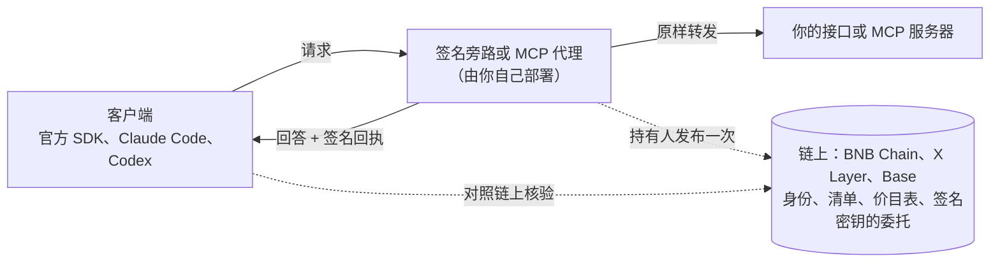

[English](README.md) | 中文

# TapeAPI

**每次 AI 调用，都附一张签名回执。** 在你的 OpenAI 或 Anthropic 兼容接口前面加一个旁路，每个回答都会带上一张任何人都能核验的
回执：谁回答的、回答的是哪个请求、回了哪些字节、声称用了多少 token、收多少钱。你的用户照旧用官方 SDK，只改 base URL，
不改代码。

TapeAPI 是 [TapeOut](https://tapeout.net) 的签名 API 层。同一套链上身份和签名，也用在 MCP 工具、容器之间端到端加密的通道与
群聊上，支持 BNB Chain、X Layer 和 Base。

[](https://github.com/BruceLanLan/tapeapi/actions/workflows/ci.yml)
[](LICENSE)
[](LICENSE-SPEC)
[](https://tapeapi.fun/docs/zh/)
[](https://tapeapi.fun/playground/)
[](https://tapeapi.fun/status/)

[English](README.md) · [网站](https://tapeapi.fun) · [手册](https://tapeapi.fun/docs/zh/) · [指南](docs/guides/zh-CN/) · [规范](spec/) · [示例](examples/) · [更新日志](CHANGELOG.md) · [路线图](docs/ROADMAP.md) · [升级到 2.0](docs/guides/zh-CN/upgrade-2.0.md)

> **2.0：标准即默认。** 不传任何选项，`createTapeAPI()` 就按 TapeOut 官方 TAP 的规定解析服务：TAP-10 v1.1 §3 至 §7
> 与 TAP-11 §2，所有读取钉在同一个区块上，链 ID 与持有人要所有节点一致；名字从未开通（`not-opened`）、未激活或付费到期
> （`unpaid`）、TapeOut 的站点存储或付费合约换成了 SDK 不认识的实现（`store-changed`），都会得到一个明确的状态，而不是悄悄
> 解析成功。TAP-11 与 TAP-13 是我们起草并提交的草稿，编辑已把两份合并进官方仓库，状态是 **Draft**；合并为 Draft 不等于被采纳。
> TAP-10 与 TAP-11 还是 Draft，默认按一条规则跟随它们的文本：放宽与新增状态名在 2.x 次版本里生效，收紧先作为可选 profile、
> 默认到 3.0 才切。要 1.x 的行为，只需一个选项 `conform: false`（已弃用，整个 2.x 保留）。一个已知例外：不开 `allChains` 时，
> "处理器合约#ID"会被拒绝，见[升级到 2.0](docs/guides/zh-CN/upgrade-2.0.md)。2.0 同时把私密通道与群聊的标签换成 TAPs 编辑要求的
> `tape-channel/`、`tape-group/`。[2.0 新增](#20-新增) · [升级到 2.0](docs/guides/zh-CN/upgrade-2.0.md)

> **实验性，在 2.0 首次公开：有界代理（Bounded Agents）。** AI 代理可以替容器花钱，但容器最多会亏多少，由托管合约算死、
> 任何人都能在链上核对：每个服务一条托管通道，代理用一把一次性的会话钥匙，限额器绝不签出超过上限的凭证，重启后接着处理订单，
> 钥匙与订单记录加密保存。**边界如实说：**托管合约**未经审计、未部署**，所以今天在主网上不可用；只在本地链与测试中可以验证；
> `@tapeapi/sdk/agent` 不受 2.x 兼容承诺约束。[有界代理](#有界代理实验性主网不可用)

> **状态：正式版（2.1.0）。** 今天上线的一切都免费。遵循语义化版本：按 2.0 文档写的代码，在所有 2.x 版本里都能继续工作；
> 2.0.0 发布后 1.x 继续获得 6 个月的安全修复。付费调用（TAPI-22）是实验性的，没有部署。所有代码和合约都没有经过第三方审计。
> **安全说明：**1.0.0 至 1.4.0 的流式 AI 回执核验，在特定分块下可能把被截断或被注入内容的流显示为“已核验”；1.5.0 已修复
> （[更新说明](https://github.com/BruceLanLan/tapeapi/releases/tag/v1.5.0)）。

## 能做什么

- **签名回答与回执**（1.0 起稳定）。每个回答都由电路持有人在链上委托的密钥签名，并与它的请求绑定；AI 调用另有一张用量回执，按链上价目表计价。[调用服务](docs/guides/zh-CN/consume.md) · [AI 服务方指南](docs/guides/zh-CN/ai-providers.md)
- **按 TapeOut 官方 TAP 解析**（2.0 起为默认）。名字按 TAP-10 v1.1 与 TAP-11 §2（Draft）解析，钉在同一个区块上，每个失败都带 TAP 里的状态名（`e.data.status`）。1.4 起以可选的 `conform: 'tap10'` 提供；`conform: false` 在整个 2.x 保留 1.x 的解析方式。状态名只增不改，在 2.0 里仍是实验性的。[升级到 2.0](docs/guides/zh-CN/upgrade-2.0.md)
- **MCP 工具**（1.0 起稳定）。结果带签名和回执，工具定义的哈希钉在链上：有公共端点，有给你自己服务器用的签名代理，还有在本地逐个核验的 `tapeapi-mcp`。[MCP 指南](docs/guides/zh-CN/mcp.md)
- **私密通道与群聊**（1.0 起稳定；2.0 起默认使用规范第 2 版，标签以 `tape-channel/`、`tape-group/` 开头）。容器之间端到端加密，经中继或 ChannelBus 传递。[私密通道](docs/guides/zh-CN/channels.md) · [群聊](docs/guides/zh-CN/groups.md)
- **流式 AI 回执，用量也能核验**（1.5 至 1.6）。被截断或被追加内容的流，回执核验不通过；可选的 `requestUsage` 把流式 OpenAI Chat 回答的用量放进签名的流里，像整段回答一样核对（它不证明上游自己的计数）。[流式 Chat 的用量：三条路](docs/guides/zh-CN/ai-providers.md#流式-chat-的用量三条路)
- **容器代理**（实验性）。阶段 0（1.7）：持有人签名的授权书、从报价到验收的任务线程、只读的付款核验，不需要新合约，不做强制执行。有界代理（2.0）：写了金额的授权书由托管通道强制执行，只在本地链与测试中可用。[容器代理](docs/guides/zh-CN/container-agents.md) · [有界代理](#有界代理实验性主网不可用)
- **美元报价、BEM 结算，以及容器之间的评价**（2.0，实验性）。我们以拉取请求提交、尚未合并的两份 TAP 草稿（#52、#54）的参考实现。托管合约没有部署，所以不收任何费用。[见下](#20-里另外两项实验性功能)

## 2.0 新增

2.0 只有一个主题：我们向 TapeOut 官方 TAP 流程提交的规则，以及 TapeOut 自己规定的规则，就是你什么都不传时 SDK 的行为（有一个已知例外，见下）。
每一项破坏性修改和对应的改法见[从 1.x 升级到 2.0](docs/guides/zh-CN/upgrade-2.0.md)；TAPI-20 至 TAPI-27 的线上格式与冻结常量一个
字节都不变，所以 2.0 的客户端照样核验所有 1.x 的清单、委托、签名回答和回执。

### 标准即默认

```js
import { createTapeAPI, rpcUrlsFor } from '@tapeapi/sdk'

// 2.0：按 TAP-10 / TAP-11 §2 解析，正是 1.x 里 conform: 'tap10' 的行为
const api = createTapeAPI({ rpcUrls: rpcUrlsFor(56) })
// 2.0：1.x 的解析方式，请求逐个相同（已弃用；整个 2.x 保留；建客户端时 onWarning 提示一次）
const legacy = createTapeAPI({ rpcUrls: rpcUrlsFor(56), conform: false })
```

| | 1.x 默认 | 2.0 默认 |
|---|---|---|
| 怎么解析 | TapeAPI 自己的方式（TAPI-20） | TAP-10 v1.1 §3 至 §7 与 TAP-11 §2 |
| 读取用哪个区块 | 最新块，不钉定 | 一个 TAP-10 钉块，按块号和哈希确认 |
| 节点怎样算一致 | 多数运营方一致 | `eth_chainId`、`ownerOf` 与合约持有人的 EIP-1271 调用要所有运营方都作答且一致；其余多数一致 |
| 从未开通的名字 | 清单有效就解析成功 | `SITE_STATUS`，`data.status: 'not-opened'` |
| 未激活或付费到期的名字 | 解析成功 | `SITE_STATUS`，`data.status: 'unpaid'` |
| TapeOut 升级了站点存储或付费合约 | 解析成功，只告警 | `CONTRACT_UNKNOWN`，`data.status: 'store-changed'`（失败关闭，直到补丁版收录新实现） |
| 自定义地址、本地链或分叉、显式 `pin` | 允许 | 建客户端时 `INVALID_ARGUMENT`，提示传 `conform: false` |
| "处理器合约#ID"字符串 | 在本链解析 | `INVALID_ARGUMENT`，`data.status: 'unsupported'`，除非 `allChains: true`（TAP-11 §2.1 的已知例外） |
| 清单缓存多久 | 3,600 秒 | 60 秒 |

TAP-10 与 TAP-11 是合并为 Draft 的（合并不等于被采纳），文本还可能改。改动时：放宽与新增状态名在 2.x 的次版本里直接成为默认；
收紧先作为可选的新 profile 提供，默认到 3.0 才切换。状态名只增不改。`conform: false` 完全不跟随 TAP。
[默认如何跟随官方 TAP 的变化](docs/guides/zh-CN/upgrade-2.0.md#默认如何跟随官方-tap-的变化)

- **按 `e.data.status` 分支**，不要按错误信息：状态名就是 TAP 里的小写名（`unsupported`、`hub-changed`、`container-mismatch`
  是 TapeAPI 自己的名字）。状态名只增不改；`data.status` 在 2.0 里仍是实验性的（它跟随的是 Draft），待 TAP-11 评审期满且无未解决的
  异议后再考虑升为 Stable。`not-opened`、`unpaid` 要服务方自己处理（不要重试），
  `store-changed` 要升级 SDK（临时办法是 `conform: false`），`unavailable` 是节点问题（重试，或加一个自己的运营方）。
- **命令行跟着变。** `tapeapi-verify`、`tapeapi-mcp`、`tapeapi-doctor` 都用新默认，输出里写明用了哪种解析，加 `--no-conform`
  回到 1.x 的方式。在默认下，`tapeapi-doctor` 对未激活的名字**判为失败**（默认客户端解析不了它）；加 `--no-conform` 仍只是警告。
- **代理工具包也一样。** 不给 `resolve` 时，`createAgentKit`（`@tapeapi/sdk/agent`，实验性）按 TAP-11 §2 解析代理与服务方。
- **`dev: true` 就等于 `conform: false`**，不出弃用提示：开发模式本来就不核对链上身份。
- **代价。** 在 BNB Smart Chain 上用默认节点实测：冷客户端解析一个服务，约 45 次 JSON-RPC 调用，1.x 约 24 次（约 2 倍）；同一
  客户端再解析一次约 36 次，1.x 约 9 次（约 4 倍）。公共节点限流时，先给 `rpcUrls` 加一个自己的运营方。
- **我们怎么核对的。** 637 个用例的差分测试：`conform: false` 在全部 637 个用例里与 1.8.1 的默认发出相同的请求、顺序相同、
  结果相同（只允许两处差异：弃用提示，以及 `chain.channelKeys` 报告的收件房间变成第 2 版的房间）。我们自己的 `11.1013.tape`
  与 `12.1013.tape` 按 TAP-10 的方式在主网上解析正常，两者都已激活，付费到 2036-08-09。
- **如果你提供服务：** 用 2.0 的安装跑 `tapeapi-doctor <你的名字>`。前 7 项（name 至 delegation）通过，2.0 的客户端就能解析你；之后各项是针对 AI 服务的，不是 AI 服务的会在 `ai-field` 失败，与 1.x 相同。名字的付费一旦到期，
  2.0 客户端看到的是 `unpaid`，回执核验页也不能再核验你的服务在付费期间签发的回执。

### 其它破坏性修改

- **私密通道与群聊默认使用 TAPI-26 v2 与 TAPI-27 v2：**标签以 `tape-channel/`、`tape-group/` 开头，不再是 `TAP-26/`、
  `TAP-27/`，这是 TAPs 编辑在合并草稿 #12、#20 之前提出的要求。`labels: 'v1'` 选用第 1 版（2.x 内弃用，不删除）。两个版本
  不互通，也不会失败放行：不一致的双方会超时，或得到一个写明不一致的错误（`data.labels`、`data.peerLabels`）。群聊终身保持
  创建时的版本，1.x 的群恢复后仍是第 1 版。通道记录、中继和 ChannelBus 都不变，持有人不需要重新签任何东西。
- **`TapeAPIError` 去掉了弃用的顶层别名**（即 `e.data` 里各字段的顶层别名）：读 `e.data.*`，1.0 起所有细节都在那里（完整列表见升级指南）。
- **通道模块把调用方自己的选项或参数错误报为 `INVALID_ARGUMENT`**，与其它模块一致；TAPI-26 数据本身出错仍是 `CHANNEL_INVALID`。

### 有界代理（实验性，主网不可用）

阶段 0（1.7）只记录谁可以替哪个容器做哪件任务，什么都不强制执行。有界代理是阶段 1：代理可以替容器花钱，而容器最多会亏多少，
由托管合约算死、可以在链上核对。电路持有人为代理可以付费的每个服务各充值一条托管通道，并把一把只为这份授权书生成的钥匙授权为
这些通道上的会话钥匙，有效期到授权书到期为止。代理的钥匙泄露或代理作恶，损失最多是放进这些通道的钱，而且只能付给授权书点名的服务。

- **核验。** `verifyMandate` 与 `verifyTaskThread` 加 `{ enforcement: 'escrow-channel' }` 时，在同一个钉块上读取每条有上限的
  通道，全部读数通过才报告“已强制执行”；链上真正限住的始终是通道余额（`bound: 'channel'`）。
- **持有人的计划。** `holderPlan` 从链上读取事实，给出未签名的 `approve`、`fund`、`authorizeSession` 交易，从持有人钱包或经容器
  发出；`afterPlan` 读回核对，`closeOut` 取回剩余的钱。会话历史防止同一份计划跑两次、给同一把钥匙充两次值。
- **代理自己的限额。** `createSpendLimiter` 绝不签出累计超过“开始时通道的 `claimedOf` 加上限”的凭证；默认拒绝单次超过上限 10% 的调用。
- **重启。** 配一个钥匙保险箱（`passphraseKeyVault`：scrypt 与 XChaCha20-Poly1305），代理的会话钥匙，以及 `examples/agent-service`
  里的订单记录，都加密保存；`resume` 在重启后接着处理订单，已停止、已撤销或已过期的订单绝不恢复。
- **交付里的钱。** 交付可以附上代理签名的花费声明，与链上读数和回执逐项对账。

**边界。** 它依赖的托管合约（TAPI-22，`contracts/src/TapeAPIEscrow.sol`）**未经审计、未在任何链上部署**，SDK 的已审计托管列表
是空的，所以在主网上都不可用。它在 SDK 的假链上验证（`node --test examples/agent-service/agent-service-spend.test.mjs`），交易与
凭证另在本地的托管合约副本上验证（`cd contracts && forge test --match-path 'test/Phase1*'`）。它是实验性的，不受 2.x 兼容承诺
约束。阶段 1 的 TAP 草稿已提交为 [TapeOutProtocol/TAPs#60](https://github.com/TapeOutProtocol/TAPs/pull/60)（目前转为 draft PR，暂不占评审队列），它依赖的托管接口已提交为
[#59](https://github.com/TapeOutProtocol/TAPs/pull/59)（目前转为 draft PR，暂不占评审队列）。

### 2.0 里另外两项实验性功能

- **美元报价、BEM 结算**（[TAPI-22](spec/TAPI-22.md) §3.6；TAP 草稿 [#52](https://github.com/TapeOutProtocol/TAPs/pull/52)，
  未合并的拉取请求）。清单可以用美元给方法定价；服务方在签名的报价里给出 BEM 汇率，客户端签凭证之前对照链上的参考池核对，每个收费的
  回答都附一张签名的收费记录。方法的 `priceBEM` 仍是单次调用最多花多少。没有 `usdPricing` 的清单，回答与付款逐字节照旧。
  托管合约没有部署，所以不收任何费用。
- **容器之间的评价**（`@tapeapi/sdk/review`；TAP 草稿 [#54](https://github.com/TapeOutProtocol/TAPs/pull/54)，未合并的拉取请求）。评价由
  评价方的持有人或其委托的密钥签名，有证据才计入：评价方收到过的签名回答，或两个容器之间的任务线程。汇总只数不同的评价方与
  持有人，从不按金额加权。`tapeapi-verify review <名字>` 可以把它们打印出来。

## 从这里开始

| 你是 | 头 5 分钟做什么 | 指南 |
|---|---|---|
| **AI 服务方或中转站**（new-api、网关、自建模型） | 在 [`examples/new-api-sidecar`](examples/new-api-sidecar/) 里 `docker compose up`，到[持有人操作台](https://tapeapi.fun/console/)发布价目表，把用户的 base URL 指向旁路，再跑一遍 `tapeapi-doctor <你的名字>` | [AI 服务方指南](docs/guides/zh-CN/ai-providers.md) |
| **MCP 服务器作者** | 在你的服务器前面跑[签名代理](examples/mcp-proxy/)，再用操作台发布清单 | [Tape out 你的 MCP 服务器](docs/guides/zh-CN/mcp.md#tape-out-你自己的-mcp-服务器) |
| **应用开发者** | 跑一遍下面的示例；用 `createVerifyingFetch` 核验 AI 回执；通道和群聊从 [`examples/group-chat`](examples/group-chat/) 开始 | [调用服务](docs/guides/zh-CN/consume.md) · [私密通道](docs/guides/zh-CN/channels.md) · [群聊](docs/guides/zh-CN/groups.md) |
| **从 1.x 升级** | 在代码里搜 `conform`、`labels`、`TapeAPIError` 的顶层别名和 `CHANNEL_INVALID`；用自定义地址或本地链的地方加 `conform: false` | [升级到 2.0](docs/guides/zh-CN/upgrade-2.0.md) |
| **TapeOut 电路持有人** | 开通电路的容器并激活名字，然后在操作台里生成服务密钥、签委托、发布清单 | [运行服务](docs/guides/zh-CN/provide.md) |
| **Claude、Cursor 等 MCP 客户端的用户** | 把 `https://api.tapeapi.fun/mcp` 添加为连接器 | [MCP 指南](docs/guides/zh-CN/mcp.md) |
| **想为容器雇一个代理，或自己做代理**（实验性） | 在仓库检出里运行 `node examples/agent-service/hire.mjs`，看每一步要钱包签什么 | [容器代理](docs/guides/zh-CN/container-agents.md) |

## 试一试

**一个带签名的回答。** 公共服务 `11.1013.tape` 提供 8 个免费的读取方法，每个都钉在一个 BNB Chain 区块上：

```bash
curl -s https://api.tapeapi.fun/tapeapi/v1/bnbUsd -H 'content-type: application/json' -d '{"id":"1","params":{}}'
```

curl 只显示签名信封，不做任何核对；核对交给 SDK。SDK 还没发到 npm，从 GitHub Release 安装（Node.js 20 或以上）：

```bash
npm install https://github.com/BruceLanLan/tapeapi/releases/download/v2.1.0/tapeapi-sdk-2.1.0.tgz
```

服务端包（`@tapeapi/server`：服务提供方、AI 旁路、MCP 代理）依赖这个 SDK，而 SDK 也不在 npm 上，所以单独安装服务端包会报 404：
请用一条命令同时安装两者，`npm install https://github.com/BruceLanLan/tapeapi/releases/download/v2.1.0/tapeapi-sdk-2.1.0.tgz https://github.com/BruceLanLan/tapeapi/releases/download/v2.1.0/tapeapi-server-2.1.0.tgz`。

```js
// try.mjs：node try.mjs
import { createTapeAPI, rpcUrlsFor } from '@tapeapi/sdk'

const api = createTapeAPI({ rpcUrls: rpcUrlsFor(56) })   // 3 家不同运营方的节点；多数读取 2 家一致即可，
                                                          // ownerOf 与 eth_chainId 要 3 家都作答且一致（严格）
const service = await api.resolve('11.1013.tape')         // 按 TAP-10 / TAP-11 §2：同一钉块、已开通、已激活
const { result, verified } = await api.call(service, 'bnbUsd', {})
console.log(result.bnbUsd, verified)                      // 验签通过才为 true
```

解析失败时，`e.data.status` 用 TAP 自己的名字说明原因：

```js
try {
  await api.resolve('11.1013.tape')
} catch (e) {
  if (e.data?.status === 'not-opened' || e.data?.status === 'unpaid') { /* 要服务方处理：不要重试 */ }
  else if (e.data?.status === 'unavailable') { /* 有节点没作答或不一致：重试 */ }
  else throw e
}
```

**本地服务、本地链或你自己的部署。** 开发模式只要 `dev`；不是 TAP-10 列出的 TapeOut 链，要传 `conform: false`，否则
`createTapeAPI()` 直接报 `INVALID_ARGUMENT`：

```js
const dev = createTapeAPI({ dev: true })                 // 本地 http:// 服务，不需要链上清单
const local = createTapeAPI({                            // anvil 本地链，用你自己部署的 TapeOut 合约
  rpcUrls: ['http://127.0.0.1:8545'], allowSingleNode: true, allowHttp: true,
  chainId: 31337, hub: HUB, factory: FACTORY, siteRegistry: SITE_REGISTRY,
  conform: false,                                        // 1.x 的解析方式；已弃用，2.x 内保留
})
```

**AI 回执。** 把 `createVerifyingFetch` 接进官方 OpenAI SDK（`npm install openai`；Anthropic SDK 同样接受 `fetch`）。
把 `42.1013.tape` 换成服务方的 TapeOut 名字：

```js
import OpenAI from 'openai'
import { createTapeAPI, rpcUrlsFor, ai } from '@tapeapi/sdk'

const api = createTapeAPI({ rpcUrls: rpcUrlsFor(56) })
const service = await api.resolve('42.1013.tape')        // AI 服务方的名字（示例）
const { baseUrl } = service.manifest.ai.endpoints.find((e) => e.format === 'openai-chat')
const client = new OpenAI({
  baseURL: baseUrl,                                      // 服务方发布在链上的地址
  apiKey: process.env.API_KEY,                           // 你在该服务方的密钥，照旧
  fetch: ai.createVerifyingFetch({ api, service }),      // 核验每张回执，不通过就抛错
})
const r = await client.chat.completions.create({ model: 'gpt-4o-mini', messages: [{ role: 'user', content: 'Hello' }] })
console.log(r.choices[0].message.content)
```

链上还没有外部服务方发布价目表，所以这段代码是对 [`examples/ai-proxy`](examples/ai-proxy/) 里的参考旁路（本地开发模式）
实际跑通的；接真实服务方时只换名字。

**Claude Code 和 Codex** 自己读不到回执。在本机开一个核验代理，再把它们指过去：

```bash
# 终端 1（会一直运行）。42.1013.tape 是示例名：换成 AI 服务方的 TapeOut 名字
npx -y --package=https://github.com/BruceLanLan/tapeapi/releases/download/v2.1.0/tapeapi-sdk-2.1.0.tgz tapeapi-verify 42.1013.tape
```

```bash
# 终端 2，macOS 或 Linux
ANTHROPIC_BASE_URL=http://127.0.0.1:8790 claude
OPENAI_BASE_URL=http://127.0.0.1:8790/v1 codex             # Codex（或 config.toml 里的 base_url）
```

```powershell
# 终端 2，Windows PowerShell
$env:ANTHROPIC_BASE_URL="http://127.0.0.1:8790"; claude
$env:OPENAI_BASE_URL="http://127.0.0.1:8790/v1"; codex
```

`tapeapi-verify` 会打印一行 `resolution:`，写明用了哪种解析；加 `--no-conform` 用 1.x 的方式。照原样运行
`tapeapi-verify 42.1013.tape` 会停下：这个名字是示例名，链上没有以它发布的服务。不依赖任何服务方、想看回执端到端核验通过，
就在本仓库的检出里跑本地试跑（不需要密钥、电路，也不花钱），先在根目录安装一次依赖：

```bash
git clone https://github.com/BruceLanLan/tapeapi.git && cd tapeapi
npm ci --no-audit --no-fund
node examples/relay-trial/trial.mjs
```

自己要做 AI 服务？从[从零到上线](docs/guides/zh-CN/ai-providers.md#从零到上线)开始；服务方的检查工具 `tapeapi-doctor`（实验性）
在同一个发布包里。

**MCP。** 同样的 8 个读取方法也是 MCP 工具，地址是 `https://api.tapeapi.fun/mcp`，每个结果都带签名回执：

```bash
claude mcp add --transport http tapeapi https://api.tapeapi.fun/mcp
```

什么都不想装：[调试台](https://tapeapi.fun/playground/)在浏览器里跑同一个 SDK。

## 各部分怎么配合



| 层 | 是什么 | 规范 |
|---|---|---|
| **身份** | 一枚 TapeOut 电路的 ERC-6551 容器。谁持有电路，谁就拥有这个服务；电路转手，服务跟着走。按 TAP-10 与 TAP-11 §2 解析。 | [TAPI-20](spec/TAPI-20.md)、[TAP-11](https://github.com/TapeOutProtocol/TAPs/blob/main/TAPs/TAP-11.md)（Draft） |
| **清单** | 容器链上站点里的 `.well-known/tapeapi.json`：接口地址、方法、AI 价目表、MCP 工具定义的哈希、签名密钥，以及持有人对这把密钥的委托。 | [TAPI-20](spec/TAPI-20.md) |
| **签名回答与回执** | 每个回答都有签名，并和它的请求绑定；AI 调用另有一张用量回执。 | [TAPI-21](spec/TAPI-21.md)、[TAP-13](https://github.com/TapeOutProtocol/TAPs/blob/main/TAPs/TAP-13.md)（Draft） |
| **通道与群聊** | 端到端加密，经中继或 ChannelBus 传递；承载方只看得到密文。 | [TAPI-26 v2](spec/TAPI-26-v2.md)、[TAPI-27 v2](spec/TAPI-27-v2.md) |

## 回执能证明什么，不能证明什么

回执能证明：**谁回答的**（电路持有人在链上委托的密钥）、**回答的是哪个请求**（请求的确切字节）、**回了哪些字节**，以及
**声称的用量和价格**（按链上价目表计算）。

回执**不证明实际跑的是哪个模型**：服务方可以把便宜模型的回答标成贵的。签名带来的是可追责：回执无法抵赖，任何人用
[抽检探针](examples/spot-check/)发测试请求并公开结果，都会留下证据。

## 现状与承诺

- **已上线，免费，无需注册：** 公共服务 `api.tapeapi.fun`（8 个方法）和它的 MCP 端点，公共中继 `relay.tapeapi.fun`
  （`relaySend`、`relayHandshake`、`relayRecv`），[ChannelBus](https://bscscan.com/address/0x486110c35d9b90a9d6D85c8063A065f9e7b6b707)，
  以及网站上的[持有人操作台](https://tapeapi.fun/console/)、[回执核验页](https://tapeapi.fun/verify/)、
  [调试台](https://tapeapi.fun/playground/)和[状态页](https://tapeapi.fun/status/)。
- **可用，由你自己部署：** AI 签名旁路与 new-api 一键包、MCP 签名代理、`tapeapi-verify`、`tapeapi-mcp`、抽检探针，
  以及 SDK 里的群聊一步投递（`deliverGroupUpdate`）。
- **实验性，未部署：** 付费调用与托管合约（[TAPI-22](spec/TAPI-22.md)，§3.6 为美元报价、BEM 结算）、服务目录、可由电路验证的方法
  （[TAPI-25](spec/TAPI-25.md)）。
- **实验性，在 SDK 里：** 容器代理（`@tapeapi/sdk/agent`：阶段 0 自 1.7 起，有界代理自 2.0 起，只在本地链可用）与评价
  （`@tapeapi/sdk/review`，自 2.0 起），不受 2.x 兼容承诺约束。
- **2.0 承诺什么：** 按 2.0 文档写的代码，在所有 2.x 版本里都能继续工作；除了标注 `@experimental` 或 `@internal` 的，其余全部是
  稳定的；其中包括 `data.status`、`SiteStatus` 与 `svc.conform`，它们跟随的是 Draft：TAP-10 与 TAP-11 还是 Draft，默认按一条规则
  跟随它们的文本，放宽与新增状态名在 2.x 次版本里生效，收紧先作为可选 profile、默认到 3.0 才切。`conform: false` 与 `labels: 'v1'` 已弃用，整个 2.x 保留。2.0.0 发布后 1.x 继续获得 6 个月的安全修复。从 1.x 升级：
  [升级到 2.0](docs/guides/zh-CN/upgrade-2.0.md)。
- **我们不做的事：** 不替任何人托管旁路（它会经手你用户的 API 密钥，只能你自己部署）；不发币；不帮任何人绕开上游服务商的
  封禁或地区限制（TapeAPI 只面向在上游条款范围内经营的服务方）。
- **链：** BNB Chain（chainId 56）什么都能做，将来的支付也只在这条链上。X Layer（196）和 Base（8453）只读：身份、解析、
  回执和 MCP 核验。X Layer 只有两家独立的 RPC 运营方，在 2.0 默认下每次严格读取两家都必须作答。
- **没有经过第三方审计。** 测试：JavaScript 测试（`npm test`）、合约测试（`forge test`），另有一份独立的 Python 实现核对每一处
  签名、哈希和编码（`python3 spec/vectors/verify.py`）；三者在每次推送时都由 CI 运行。在 2.1.0 的发布提交上，本仓库的 `npm test`
  共 2,121 项 JavaScript 测试：2,118 项通过，3 项跳过，0 失败。

## 隐私，如实说

- **受保护的：** 通道和群聊的内容（端到端加密）；AI 回执只带哈希，经 SDK 或 `tapeapi-verify` 发出的请求还会追加 128 位
  随机空白，短提示词没法靠猜哈希对上；MCP 核验链接默认只带哈希；SDK 的 `busPrivacyReader`（实验性）读取整个 ChannelBus 后在本地
  筛选，节点看不出你的房间。
- **藏不住的：** 服务方看得到它处理的一切（你的请求、IP 和 API 密钥）；公共 RPC 节点看得到你的 IP 和你在核验哪个服务；
  中继和链看得到通道的房间、时间和大小；链上的一切都是公开的，将来的付款也一样。2.0 默认仍不开 `allChains`，因为一开就会把
  你的查询发给其它链的公共节点。因此"处理器合约#ID"字符串默认被拒绝（TAP-11 §2.1 的已知例外，见[升级到 2.0](docs/guides/zh-CN/upgrade-2.0.md)）。

## 费用

无强制协议费；默认 1% 维护贡献，任何服务方都可以关闭；运营方没有费率开关。这 1% 只在付费通道结算时从服务方所得中扣，
用户的价格不变。服务方也可以设得更高，但不超过合约上限 20%。付费托管合约尚未部署，所以**今天所有调用都不收费**。AI 服务方
照旧在链下向用户收费；清单里的价格是公开的声明，不经过结算。送审的托管合约计划首先托管 BEM，USDT 锚定币与 WBNB 按需
（[TAPI-22](spec/TAPI-22.md) §3.5）。详见 [docs/FEES.md](docs/FEES.md)。

## 规范

这些是 TapeAPI 自己的规范，不是 TAP。TapeOut 的标准以 TAP 的形式发布，由 [TapeOutProtocol/TAPs](https://github.com/TapeOutProtocol/TAPs)
的编辑按 TAP-01 编号。我们就其中部分内容提交了 14 份 TAP 草稿：8 份在 2026-09-30 至 10-01，2 份关于容器代理格式在 2026-10-04 与
10-05，2 份在 2026-10-08（付费凭证、评价），2 份在 2026-10-13（托管通道、有界代理）。其中 2 份已合并为 Draft（TAP-11、TAP-13），
12 份是尚未合并的拉取请求，其中 #54、#59、#60 目前转为 draft PR，暂不占用编辑的评审队列。另有 1 份 Information 草稿 #61（已提交，目前转为 draft PR）。编辑审的是格式而不是方案
本身（TAP-01 §4），所以合并为 Draft 不等于被采纳。TAPI-20 至 TAPI-27（含 TAPI-26、TAPI-27 的第 2 版）仍是 2.x 兼容性承诺的依据。

| 我们的规范 | 草稿（拉取请求） | 状态（截至 2026-10-17） |
|---|---|---|
| TAPI-20（核心：§3.1 至 §3.4、§3.6、§3.10） | 服务身份与清单，[#8](https://github.com/TapeOutProtocol/TAPs/pull/8) | 2026-10-01 合并为 [TAP-11](https://github.com/TapeOutProtocol/TAPs/blob/main/TAPs/TAP-11.md)，Draft。2.0 默认按它的 §2 解析 |
| TAPI-21 | 签名响应，[#10](https://github.com/TapeOutProtocol/TAPs/pull/10) | 2026-10-04 合并为 [TAP-13](https://github.com/TapeOutProtocol/TAPs/blob/main/TAPs/TAP-13.md)，Draft |
| TAPI-26（v2） | 私密通道，[#12](https://github.com/TapeOutProtocol/TAPs/pull/12) | 开放中；已改用编辑要求的 `tape-channel/` 标签，即 2.0 的默认 |
| TAPI-20 §3.8、TAPI-21 | MCP 工具绑定，[#16](https://github.com/TapeOutProtocol/TAPs/pull/16) | 开放中；它要求的草稿（TAP-11、TAP-13）已合并为 Draft |
| TAPI-23 | 多家独立服务的交叉验证读取，[#18](https://github.com/TapeOutProtocol/TAPs/pull/18) | 开放中；它要求的草稿（TAP-11、TAP-13）已合并为 Draft |
| TAPI-27（v2，仅格式 1） | 私密群聊，[#20](https://github.com/TapeOutProtocol/TAPs/pull/20) | 开放中；已改用编辑要求的 `tape-group/` 标签，即 2.0 的默认 |
| TAPI-20 §3.9、TAPI-21 §3.5 | AI 用量回执，[#26](https://github.com/TapeOutProtocol/TAPs/pull/26) | 开放中；已按编辑在 #25 的答复修订 |
| TAPI-20 §3.2（证明模式，说明性） | 证明核验读取，[#28](https://github.com/TapeOutProtocol/TAPs/pull/28) | 开放中 |
| 容器代理授权书与任务消息，阶段 0（没有对应的 TAPI 规范） | [#47](https://github.com/TapeOutProtocol/TAPs/pull/47) | 开放中 |
| 清单里的代理成员（#41 的上架部分） | [#49](https://github.com/TapeOutProtocol/TAPs/pull/49) | 开放中 |
| TAPI-22 §3.1、§3.2、§3.6 | 付费凭证：美元报价、BEM 结算，[#52](https://github.com/TapeOutProtocol/TAPs/pull/52) | 开放中 |
| 没有对应的 TAPI 规范（`@tapeapi/sdk/review`） | 有证据的容器间评价，[#54](https://github.com/TapeOutProtocol/TAPs/pull/54) | 开放中（draft PR） |
| TAPI-22 §3.3 至 §3.5（托管接口） | 支付容器服务的托管通道（Standards），[#59](https://github.com/TapeOutProtocol/TAPs/pull/59) | 开放中（draft PR） |
| 容器代理，阶段 1：有界代理（没有对应的 TAPI 规范） | 由托管通道强制执行的容器代理授权书（阶段 1），[#60](https://github.com/TapeOutProtocol/TAPs/pull/60) | 开放中（draft PR） |
| 没有对应的 TAPI 规范（Information 草稿） | 容器网站、消息与服务的隐私地图（Information），[#61](https://github.com/TapeOutProtocol/TAPs/pull/61) | 开放中（draft PR） |
| TAP-11 的后续修改 | 安全说明补一句 `verifyingContract` [#35](https://github.com/TapeOutProtocol/TAPs/pull/35)、说明性中文译文 [#36](https://github.com/TapeOutProtocol/TAPs/pull/36)；删去对 `TAP-26/` 标签的提及 [#51](https://github.com/TapeOutProtocol/TAPs/pull/51)；两句澄清：`priceBEM` 可作单次调用的上限、托管合约所在的链由谁规定 [#53](https://github.com/TapeOutProtocol/TAPs/pull/53)；参考实现更新到当前版本，并加一条以 `resolved` 结束的主网向量 [#55](https://github.com/TapeOutProtocol/TAPs/pull/55) | #35、#36 于 2026-10-04 合并；#51、#53、#55 等待编辑处理 |
| TAP-13 的后续修改 | 保留名的措辞，[#46](https://github.com/TapeOutProtocol/TAPs/pull/46)；参考实现一节里一句过时的话 [#56](https://github.com/TapeOutProtocol/TAPs/pull/56) | #46 于 2026-10-05 合并；#56 等待编辑处理 |

TAPI-22（§3.1 至 §3.6 以外）、TAPI-24、TAPI-25 没有提交。编辑给其它草稿分配编号后，我们会把引用改成对应编号。

| 规范 | 标题 | 状态 |
|---|---|---|
| [TAPI-1](spec/TAPI-1.md) | TapeAPI 的文档流程与状态，含 Stable (vN) | Draft |
| [TAPI-20](spec/TAPI-20.md) | 服务身份与清单，含 AI 价目表与多链名字 | Stable (v1)（稳定）；§3.5 实验性 |
| [TAPI-21](spec/TAPI-21.md) | 签名响应信封，含 AI 用量回执 | Stable (v1)（稳定） |
| [TAPI-22](spec/TAPI-22.md) | 计量支付：凭证与托管；托管资产（§3.5，BEM 优先）与美元报价、BEM 结算（§3.6） | Experimental（实验性） |
| [TAPI-23](spec/TAPI-23.md) | 多家交叉验证的读取 | Stable (v1)（稳定） |
| [TAPI-24](spec/TAPI-24.md) | 跨链意图询价 | Withdrawn（已撤回） |
| [TAPI-25](spec/TAPI-25.md) | 可由电路验证的方法 | Experimental（实验性） |
| [TAPI-26 v2](spec/TAPI-26-v2.md) | 容器间的私密通道，`tape-channel/` 标签 | Stable (v2)（稳定），2.0 起为 SDK 默认 |
| [TAPI-27 v2](spec/TAPI-27-v2.md) | 最多 32 个容器的私密群聊（实验性的格式 2 最多 128 个），`tape-group/` 标签 | Stable (v2)（稳定），2.0 起为 SDK 默认 |
| [TAPI-26](spec/TAPI-26.md)、[TAPI-27](spec/TAPI-27.md) | 两者的第 1 版：内容相同，使用冻结的 `TAP-26/…`、`TAP-27/…` 标签 | Stable (v1)（稳定）；2.x 中用 `labels: 'v1'`（已弃用） |

规范中英双语，以英文为准。**TAPI-1 与 TAPI-20 至 TAPI-27 是 TapeAPI 自己的文档名，不是 TAP 编号。**含有旧名字的冻结常量（例如第 1 版
的 `TAP-26/…`、`TAP-27/…` 标签）永不改变；第 1 版保持 Stable (v1)，最早在第 2 版成为 Stable 12 个月之后才可能撤回（TAPI-1 §4.1）。

## 仓库

[`sdk/`](sdk/) `@tapeapi/sdk`（解析、调用、验签、AI 回执、通道、群聊、MCP、容器代理、评价）·
[`server/`](server/) `@tapeapi/server`（服务端、AI 旁路、MCP 代理）·
[`contracts/`](contracts/)（ChannelBus，以及实验性的托管合约和服务目录）·
[`spec/`](spec/)（各规范、测试向量、Python 验证器）· [`examples/`](examples/) ·
[`conformance/`](conformance/) · [`site/`](site/)（网站）· [`docs/`](docs/README.md)。
合约地址见[入门](docs/guides/zh-CN/introduction.md#链上地址)。

安全问题请按 [SECURITY.md](SECURITY.md) 私下报告。欢迎提 issue 和 pull request，见 [CONTRIBUTING.md](CONTRIBUTING.md) 与
[行为准则](CODE_OF_CONDUCT.md)。

## 许可证

代码采用 MIT（[LICENSE](LICENSE)）：`contracts/`、`sdk/`、`server/`、`examples/`、`conformance/`、`scripts/`、`site/`。
`spec/` 里的规范采用 CC0-1.0（[LICENSE-SPEC](LICENSE-SPEC)）。

## 致谢

为 TapeOut 做一个服务层的想法，也就是“DeWEB 是网站，TapeSend 是消息，TapeAPI 是服务”，来自
**[@Theairresearch](https://x.com/Theairresearch/status/2101640697426448632)**。TapeAPI 的收入自 2026-10-05 起，按季度扣除第三方现金成本后，余额的 10% 永久归他们（口径见 BUSINESS.md）。

构建于 [TapeOut](https://tapeout.net) 与 [TapeKit](https://github.com/TapeOutProtocol/TapeKit) 之上。
